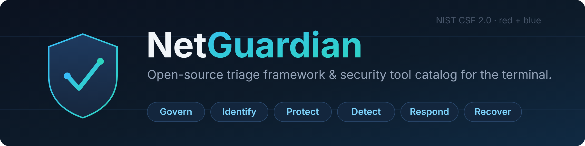
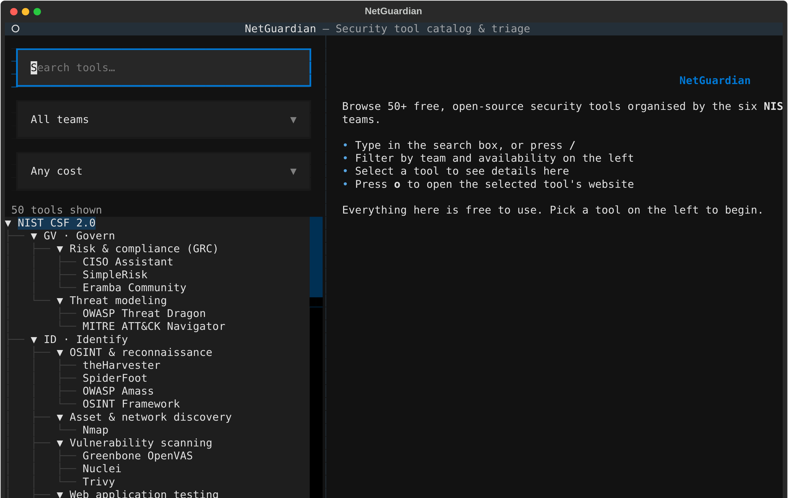

<div align="center">



<br>

**Browse, filter, and launch 50+ free security tools — then run your triage from the same terminal.**
Organised around [NIST CSF 2.0](https://www.nist.gov/cyberframework), tagged for blue team and red team,
inspired by the [OSINT Framework](https://osintframework.com/).

<br>

[](LICENSE)
[](pyproject.toml)
[](https://textual.textualize.io/)
[](#-whats-inside)
[](https://www.nist.gov/cyberframework)
[](CONTRIBUTING.md)

[**Features**](#-features) · [**Install**](#-install) · [**Usage**](#-usage) · [**Catalog**](#-whats-inside) · [**Triage**](#-triage-workspace) · [**Contributing**](#-contributing)

</div>

---

## Why NetGuardian?

Security folks juggle dozens of tools scattered across bookmarks, wikis and memory. NetGuardian puts the
**free** ones — overwhelmingly open-source, plus a few free community editions of proprietary tools (each
labelled) — in a single, searchable place, mapped to a framework you already report against, and adds a
lightweight **triage workspace** so you can actually run an incident or an engagement without leaving the
terminal. No accounts, no SaaS, no cost.

<div align="center">

</div>

## ✨ Features

- 🗂️ **A curated catalog** of 50+ free tools across the six NIST CSF 2.0 functions, each with its link, license, cost, platforms and tags.
- 🔎 **Search & filter** by keyword, **red / blue** team, free-only, or only the tools already installed on your machine.
- 🧰 **Triage cases** — start an incident or pentest, work a checklist mapped to NIST CSF, keep notes, and export a Markdown report.
- 🖥️ **Terminal-first, browser-optional** — the same app runs as a TUI and, with one extra dependency, in your browser. Nothing to host.
- 🧩 **Edit-a-file simple** — the catalog is plain YAML. Adding a tool is a one-file pull request.
- 💸 **Free by design** — if a tool isn't genuinely free to use, it isn't in here.

## 🚀 Install

```bash
pipx install netguardian        # recommended — isolated, always on PATH
# or
pip install netguardian
```

Then just run:

```bash
netguardian
```

<details>
<summary>Run it in a browser instead</summary>

```bash
pipx install "netguardian[web]"
netguardian --web            # serves the same app at http://localhost:8000
```
</details>

## 🧭 Usage

| Command | What it does |
|---------|--------------|
| `netguardian` | Open the terminal app |
| `netguardian --web` | Serve the app in a browser |
| `netguardian --list` | Print the whole catalog as text |
| `netguardian case new "<name>" --kind incident\|pentest` | Start a triage case |
| `netguardian case list` | List your saved cases |
| `netguardian case steps "<name>"` | List the checklist with step numbers |
| `netguardian case check "<name>" <n>` | Mark step `<n>` done (`--undo` to reverse) |
| `netguardian case note "<name>" "<text>"` | Add a note to the case |
| `netguardian case show "<name>"` | Print a case as Markdown |
| `netguardian case export "<name>" -o report.md` | Export a case report |

**In the app:** press <kbd>/</kbd> to search, filter on the left, select a tool to see details, and press <kbd>o</kbd> to open its website. <kbd>r</kbd> resets filters, <kbd>q</kbd> quits.

## 📦 What's inside

The catalog lives in `netguardian/catalog/` — one YAML file per NIST CSF function.

| | Function | Covers | Tools |
|---|----------|--------|:---:|
| **GV** | Govern | Strategy, policy, risk, GRC, threat modeling | 5 |
| **ID** | Identify | Assets, exposure, OSINT, scanning, authorised pentesting | 14 |
| **PR** | Protect | Hardening, identity, secrets, network defense | 9 |
| **DE** | Detect | SIEM, IDS, endpoint telemetry, detection rules | 10 |
| **RS** | Respond | Case management, enrichment, live forensics | 7 |
| **RC** | Recover | Backup, restore, disk imaging | 5 |

> A few highlights: **Nmap**, **OWASP ZAP**, **Nuclei**, **theHarvester**, **Wazuh**, **Suricata**, **Zeek**, **osquery**, **Sigma**, **TheHive**, **Velociraptor**, **Volatility 3**, **Restic** — and many more.

## 🧰 Triage workspace

A case bundles a NIST-CSF-mapped checklist, notes, and a Markdown report, stored as a plain JSON file you can diff and share.

```bash
netguardian case new "Phish Oct20" --kind incident
# ... work the checklist, add notes ...
netguardian case export "Phish Oct20" -o phish-oct20.md
```

Incident cases follow an Identify → Detect → Respond → Recover flow; pentest cases follow recon → discovery → exploitation → reporting. Both are starting points you're meant to adapt.

## ⚖️ Acceptable use & disclaimer

NetGuardian is built for **lawful, authorised** security work — blue-team defence, and penetration testing or red-teaming you are **explicitly authorised** to perform.

By using NetGuardian you agree to:

- Only test, scan, or assess systems you **own** or have **prior written permission** to test, and stay within the agreed scope.
- Comply with all applicable laws, regulations, and contractual obligations.

You must **not** use NetGuardian, or anything it links to, for unauthorised access, "black-hat" hacking, fraud, harassment, or any other unlawful or malicious activity. **The maintainers do not condone misuse.**

NetGuardian performs no attacks — it is a catalog and workflow aid, and the **dual-use** tools it links to each carry **their own licenses and terms**. The software is provided **"as is"**, without warranty of any kind, and the maintainers accept no liability for how you use it (consistent with GPL-3.0 §§15–16).

Full policy: [TERMS.md](TERMS.md).

## 🤝 Contributing

Adding a tool is usually a one-file edit. See **[CONTRIBUTING.md](CONTRIBUTING.md)** for the entry format and the checks.

```bash
git clone https://github.com/BladeIV/Cybersec-Framework
cd Cybersec-Framework
pip install -e ".[dev]"
pytest                          # validates every catalog entry
python scripts/check_links.py   # checks that tool links are alive
```

## 📄 License

[GPL-3.0](LICENSE) — free software; share and modify under the same license.

<div align="center">
<sub>Built for SecOps and pentest teams who want the good stuff in one place, for free.</sub>
</div>
